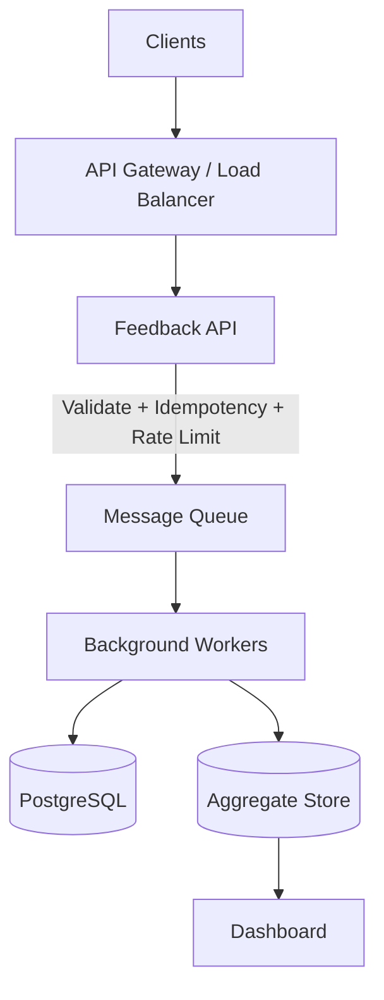
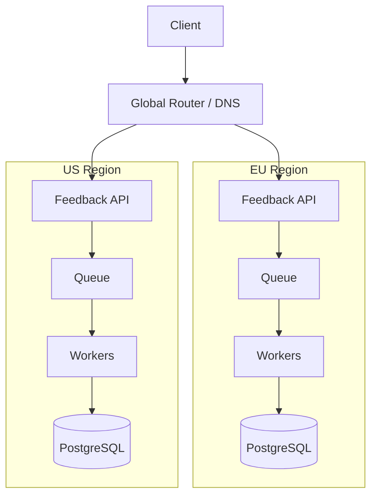

# System Design: Ölçeklenebilir Feedback Ingestion

Hedefler: yüksek hacimli ingestion, tenant izolasyonu, duplicate request'lere karşı
idempotency, birkaç dakikada güncellenen aggregate metrikler, bölgesel deployment ve
kesintisiz deploy.

### General deployment

### Regional deployment

## Bileşenler

- **API Gateway**: auth ve rate limit.
- **Feedback API**: sadece validasyon + idempotency check + DB'ye yazma yapar, ağır işi
  (sentiment, aggregation, webhook) senkron yapmaz.
- **Queue**: API ile worker'lar arasında buffer - spike'larda API ve DB korunur.
- **Workers**: sentiment analizi, aggregate güncelleme, webhook gönderimi.
- **Aggregate Store**: dashboard'ın okuduğu, önceden hesaplanmış veri.

## Kapasite (peak 10k req/s)

- **API**: stateless, LB arkasında yatay ölçeklenir - darboğaz değil.
- **Queue**: write'tan bağımsız ölçeklenir, ingestion hızını sınırlamaz.
- **Asıl darboğaz DB write path'i**: tek `feedbacks` insert + unique constraint check.
  Bunu karşılamak için connection pool sınırı, `(tenant_id, created_at)` composite
  index (bkz. README) ve gerekirse `created_at`'e göre partitioning gerekiyor.

## Sync / async

Senkron olan tek şey: tenant doğrulama, idempotency kontrolü ve feedback'in DB'ye
yazılması. Sentiment analizi, aggregation ve webhook tamamen async - bunlar hem yavaş
hem de request'in başarısı için gerekli değil.

## DB / queue / cache

- **PostgreSQL**: source of truth, unique constraint'lerle idempotency burada sağlanır.
- **Queue (Sidekiq/Redis)**: iş dağıtımı, worker'ları bağımsız ölçeklendirmeyi sağlar.
- **Redis (cache)**: rate limit sayaçları ve sık okunan tenant config'i için.

## Rate limiting

- Tenant başına rate limit - bir tenant diğerlerini etkilemesin.
- Queue çok biriktiğinde yeni isteklere 429 dönmek (load shedding).
- Worker tarafında retry + circuit breaker - bir tenant'ın yavaş downstream'i diğerini
  bloklamasın.
- **Queue seviyesinde noisy-neighbor**: tek queue'da büyük bir tenant küçükleri
  geciktirebilir - tenant tier'a göre ayrı queue / per-tenant concurrency limiti
  gerekiyor.

## Consistency vs availability

- Feedback yazımı: strong consistency, taviz verilmez.
- Aggregate/dashboard: eventual consistency kabul edilebilir, birkaç dakika gecikme
  sorun değil.
- Redis down olsa bile API kabul edip outbox'a yazabilmeli, pipeline geri gelince
  devam eder.

## Bölgesel deployment

Her bölge kendi API/queue/worker/DB stack'ine sahip, tam izole. Global router tenant'ın
bölgesine göre trafiği yönlendirir. Bölgeler arası veri replikasyonu yok, veri kendi
bölgesinde kalır.

## Observability

- **Metrikler**: request rate/latency/error oranı, queue depth, outbox'ta bekleyen
  event sayısı, DB CPU/connection pool doluluğu.
- **Log**: request/correlation ID ile uçtan uca izlenebilir, PII redact edilmiş
  structured log (bkz. code review notu).
- **Alarm**: queue depth ve p95 latency eşik aşımı, outbox'ta uzun süre `pending`
  kalan event.

## Kesintisiz deploy

- Rolling deploy: yeni versiyon eskiyle bir süre yan yana çalışır, downtime olmaz.
- Migration'lar backward-compatible yazılır.
- Job'lar idempotent olduğu için yarıda kalan iş güvenle retry edilebilir.
- Outbox pattern: pipeline tetikleme adımı başarısız olsa bile event `pending` kalır,
  bir sweeper onu yakalar - feedback kaybolmaz.
